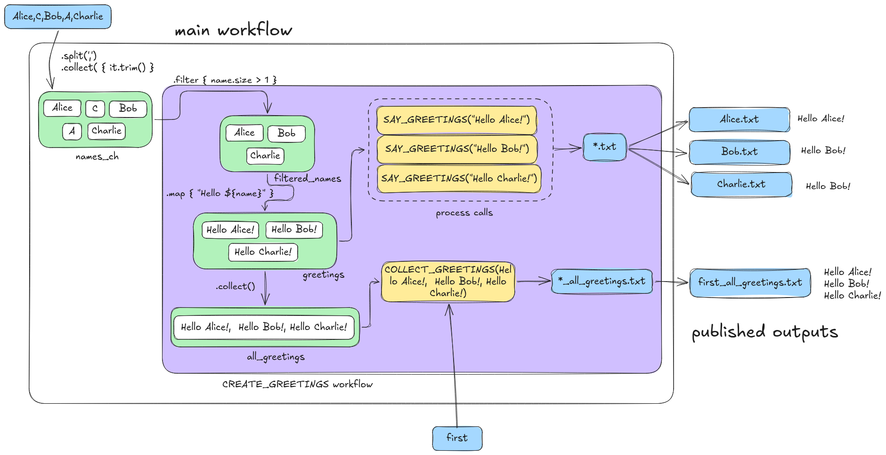
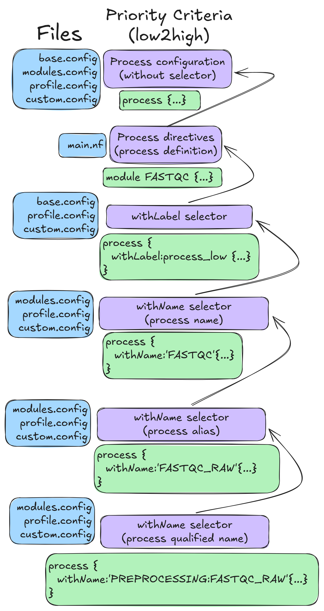
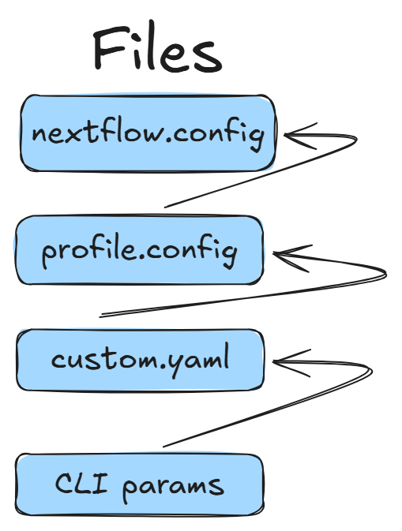

# nextflow-101-sebibc

Nextflow 101 workshop for the II SEBIBC Congress 2026

This is a simplified 60-minute workshop to get started with Nextflow, designed for the II SEBIBC Congress in 2026.

All the scripts that will be used or created during the training are available in the [`scripts/`](./scripts/) folder.

[Here](https://docs.seqera.io/nextflow/?__hstc=247481240.ccb52e68b4484858da3c13c7629ef9f4.1793699689260.1793699689260.1793704847541.2&__hssc=247481240.1.1793704847541&__hsfp=5114929bcbc4071300a47f18b670c9fc) you can find the official Nextflow documentation if you need to go deeper into it.

## Set-up

For this workshop we will need Nextflow >= 25.10.2 and any of Singularity, docker or conda.

In the workshop we will be using **miniconda** for training purposes as it is quicker and easier to install.

### Miniconda installation

You can follow the official documentation [here](https://docs.conda.io/projects/conda/en/latest/user-guide/install/linux.html#install-linux-silent)

### nf-core tools installation

We will be installing Nextflow and the nf-core tools through miniconda.

You can follow the official installation documentation [here](https://nf-co.re/docs/nf-core-tools/cli/installation)

```
conda create --name nf-core-env nf-core nextflow
conda activate nf-core-env
nf-core --version
nextflow -version
```

> Note: This training has been designed with `nf-core/tools version 4.2.1` and `Nextflow version 26.10.4`

## Hello world mini-script

This is a minimal Nextflow script adapted from the official Nextflow training [here](https://github.com/nextflow-io/training/blob/master/hello-nextflow/hello-greeetings.nf).

```bash
process SAY_HELLO {

    output:
    path 'output.txt'

    script:
    """
    echo 'Hello World!' > output.txt
    """
}

workflow {

    main:
    // emit a greeting
    SAY_HELLO()
}
```

We can just execute the script as follows:

```bash
nextflow run scripts/min-hello-greeetings.nf
```

We will see something like this:

```bash
Nextflow 26.10.5 is available - Please consider updating your version to it

 N E X T F L O W   ~  version 26.10.4

Launching `scripts/min-hello-greeetings.nf` [serene_bernard] revision: f6990be1ea

executor >  local (1)
[f9/44658b] SAY_HELLO [100%] 1 of 1 ✔
```

We can inspect the contents of the work directory (the work directory hash varies from one run to another):

```bash
ls -a work/f9/44658b*
cat work/f9/44658b*/.command.sh
cat work/f9/44658b*/output.txt
```

Output files:
- `.command.begin`: Sentinel file created by nextflow. It's empty.
- `.command.err`: Standard error
- `.command.log`: Standard error and standard output in logical order as they came out.
- `.command.out`: Standard output
- `.command.run`: What Nextflow actually executes. Depends depending if you are running it locally or in SLURM.
- `.command.sh`: The generated script which come from the process. The `.command.run` file executes this file.
- `.exitcode`: Captures the exit code from the task. Ideally, this should be 0 for a successful task. This is useful to understand what is happening when you run out of memory or something else goes wrong.
- `output.txt`: The main output from the process.

## Greetings complete-script

### Overview

This example introduces the fundamental concepts of Nextflow by building a simple workflow that generates greeting messages from a list of names.

The workflow demonstrates how to:

1. Receive an input file through a workflow parameter and create a channel from its contents.
2. Filter channel elements using operators.
3. Define processes to execute individual computational tasks.
4. Connect processes through channels.
5. Collect channel elements into a single list.
6. Pass a collected list to a process that executes once for the complete group.
7. Publish workflow outputs into organised directories.

The example uses two processes:

- `SAY_HELLO`: generates one text file per name.
- `ALL_GREETINGS`: generates a single text file containing a greeting for all names.

### Entry workflow

The entry workflow is the main execution point of the pipeline. It creates the input channel, invokes the named workflow and defines which results should be published.

#### Creating the input channel

The workflow receives the path to a text file through the `params.input` parameter.

```groovy
workflow {
    main:
    // Create a channel from the input parameter
    println "Input parameter: ${params.input}"
    input_ch = channel
        .fromPath(params.input)
        .splitText()
        .map { it.trim() }
    input_ch.view { input -> "Input channel: ${input}" }
```

This expression uses several Groovy and Nextflow features:

- `params.input`: accesses the workflow input parameter.
- `println`: displays the input parameter directly in the terminal.
- `channel.fromPath()`: creates a channel from a file path.
- `splitText()`: reads the text file and emits its contents line by line.
- `map { it.trim() }`: removes leading and trailing whitespace from each emitted line.
- `view`: prints the channel contents to the terminal without consuming them.

For example, if the input file contains:

```text
Alice
C
Bob
A
Charlie
```

#### Invoking the workflow: CREATE_GREETINGS

```groovy
CREATE_GREETINGS(input_ch)
```

The input channel is passed to `CREATE_GREETINGS`, which performs the filtering, transformation, and process execution steps.

A **workflow** defines how processes and channels are connected to create a complete computational pipeline.

The named workflow `CREATE_GREETINGS` receives a channel containing individual names and performs the following operations.

##### Workflow inputs: `take:`

The `take:` section declares the inputs required by the workflow.

In this example, the workflow receives `name`, a channel containing individual names.

##### Filtering channel elements: `filter`

The `filter` operator selects the elements that satisfy a given condition.

```groovy
    filtered_names.collect().view { names -> "Collected names: ${names}" }
```

In this example, names containing only one character are removed from the channel.

##### Collecting channel elements: `collect`

The Nextflow `collect` operator gathers all elements emitted by a channel into a single list.

```groovy
filtered_names.collect()
```

This changes the structure of the data flowing downstream:

- Before `collect`: individual names strings are emitted by the channel.
- After `collect`: a single list containing all names strings is emitted.

The resulting list is passed to `ALL_GREETINGS`.

**Key concept:** `collect` changes the data structure received downstream, from individual channel elements to a single collection.

##### Inspecting channel contents: `view`

The `view` operator prints channel elements to the console.

```groovy
    filtered_names.collect().view { names -> "Collected names: ${names}" }
```

This is particularly useful for debugging workflows and checking the values flowing through channels.

The `view` operator does not modify the channel, so its elements remain available to downstream operations.

##### Executing processes

In Nextflow, a **process** defines a computational task. It specifies the inputs required, the outputs generated and the commands to execute.

###### SAVE_GREETINGS

The `SAY_HELLO` process is invoked with the `filtered_names` channel:

```groovy
SAY_HELLO(greetings)
```

Each channel element triggers an independent process execution. Therefore, if the channel contains three names, Nextflow launches three tasks. This process receives a single name as input and writes it into an individual text file.

**Input:**
- `name`: a string containing a name.

**Output:**
- A text file named after the recipient.

For example, the input `Alice` generates the file `Alice_output.txt`, containing:

```text
Hello Alice!
```

The process uses a `val` input because the name is a value string. The `path` output declaration specifies the files generated by the task. The `*.txt` pattern allows Nextflow to capture the generated text file.

The `emit` option assigns the name `results` to this process output, making it accessible through `SAY_HELLO.out.results`.

###### ALL_GREETINGS

Unlike `SAY_HELLO`, this process receives the complete list containing all the names as a single input value and writes them into a single text file. Therefore, it executes only once, regardless of the number of names in the list.

```groovy
    ALL_GREETINGS(filtered_names.collect())
```

**Input:**
- `names`: a list of strings containing all names.

**Output:**
- `all_greetings.txt`: a file containing all greetings in one line.

For example:

```text
Hello Alice, Bob, Charlie!
```

The process uses `${names.join(', ')}` to concatenate all greetings into a single string separated by comma characters.

##### Workflow outputs: `emit:`

The `emit:` section exposes the outputs generated by the named workflow.

```groovy
emit:
greeting_files = SAY_HELLO.out.results
group_greetings = ALL_GREETINGS.out.group_results
```

The outputs are assigned descriptive names so they can be accessed by the calling workflow.

#### Publishing workflow outputs: `publish:`

The `publish:` section selects the outputs from the entry workflow that should be made available to the user.

```groovy
publish:
greeting_files = CREATE_GREETINGS.out.greeting_files
group_file = CREATE_GREETINGS.out.group_greetings
```

The two outputs are:

- `greeting_files`: individual greeting files.
- `group_file`: the file containing all greetings.

### Workflow outputs

The top-level `output {}` block configures how the published results are organised.

```groovy
output {
    greeting_files {
        path 'greeting_files'
        mode 'copy'
    }
    group_file {
        path 'group_greetings'
        mode 'copy'
    }
}
```

Each published output is assigned a destination directory relative to the workflow output directory.

The `mode 'copy'` setting instructs Nextflow to copy the files into the output directory rather than creating symbolic links.

The resulting directory structure will be:

```text
results/
├── greeting_files
│   ├── Alice_output.txt
│   ├── Bob_output.txt
│   └── Charlie_output.txt
└── group_greetings
    └── all_greetings.txt
```

This is an schema on how this mini-minipeline works:



### Running the workflow

#### No input run

The script is stored in the `scripts/hello-greeetings.nf` folder, so it is executed as follows:

```bash
nextflow run scripts/hello-greeetings.nf
```

And we will see something like this:

```bash
 N E X T F L O W   ~  version 26.10.5

Launching `scripts/hello-greeetings.nf` [jolly_ardinghelli] revision: 88b8cd4c7d

WARN: Access to undefined parameter `input` -- Initialise it to a default value eg. `params.input = some_value`
Input parameter: null
Missing `fromPath` parameter -- Check script 'scripts/hello-greeetings.nf' at line: 52 or see '.nextflow.log' file for more details
```

If we don't specify any input, as there's no default input in the code (we could have add it, but we didn't in this example), the pipeline crashes.

#### Default run

The script is stored in the `scripts/hello-greeetings.nf` folder, so it is executed as follows:

```bash
nextflow run scripts/hello-greeetings.nf --input  names.txt
```

We will see something like this:

```bash
 N E X T F L O W   ~  version 26.10.5

Launching `scripts/hello-greeetings.nf` [big_swartz] revision: 88b8cd4c7d

Input parameter: names.txt
executor >  local (4)
[ac/976994] CREATE_GREETINGS:SAY_HELLO (2) [100%] 3 of 3 ✔
[36/f7a751] CREATE_GREETINGS:ALL_GREETINGS [100%] 1 of 1 ✔
Input channel: Alice
Input channel: C
Input channel: Bob
Input channel: A
Input channel: Charlie
Collected names: [Alice, Bob, Charlie]

Outputs:

  /home/svarona/Repositories/nextflow-101-sebibc/results

  greeting_files:
    - greeting_files/Bob_output.txt
    - greeting_files/Charlie_output.txt
    - greeting_files/Alice_output.txt

  group_file: group_greetings/all_greetings.txt
```

We can see that the results were saved into the `results/` folder:

We can read the content of the different files:

```bash
$ cat results/group_greetings/all_greetings.txt
Hello Alice, Bob, Charlie!

$ cat results/greeting_files/Alice_output.txt
Hello Alice!
```

As we can see, this generated more folders in the `work` folder, so every process is individual and can't overlap or override any other process:

```bash
$ tree -L 2 work/
work/
├── 2b
│   └── bf9b0af4a803841bd89f4a83355bda
├── 32
│   └── b17aec35f72470398cc2f893058d28
├── a1
│   └── 6a8da6cec03f5e7015ada92fabef58
├── e6
│   └── 055833133c0eaffa0f15ff87751433
└── f9
    └── 44658bc7aba4cd5b07d9b411b03f29

11 directories, 0 files
```

#### Specify output directory

To specify a different output directory, different from `results/`:

```bash
nextflow run scripts/hello-greeetings.nf --input 'Alice,C,Bob,A,Charlie' --batch "second" -output-dir my_results -resume
```

Now all the files are in the `my_results/` folder, and the processes were cached from the previous run:

```bash
Nextflow 26.10.5 is available - Please consider updating your version to it

 N E X T F L O W   ~  version 26.10.4

Launching `scripts/hello-greeetings.nf` [cheesy_shockley] revision: 64301b6531

Input string: Alice,C,Bob,A,Charlie
Input string channel: DataflowBroadcast around DataflowStream[?]
executor >  local (1)
[a1/6a8da6] CREATE_GREETINGS:SAVE_GREETINGS (2) [100%] 3 of 3, cached: 3 ✔
[22/58d828] CREATE_GREETINGS:COLLECT_GREETINGS  [100%] 1 of 1 ✔
Input name: Alice
Input string: Alice,C,Bob,A,Charlie
Input name: C
Input name: Bob
Input name: A
Input name: Charlie
Greetings: Hello Alice!
Greetings: Hello Bob!
Greetings: Hello Charlie!
All greetings: [Hello Alice!, Hello Bob!, Hello Charlie!]

Outputs:

  /home/svarona/Repositories/nextflow-101-sebibc/my_results

  greeting_files:
    - individual_greetings/Charlie.txt
    - individual_greetings/Bob.txt
    - individual_greetings/Alice.txt

  all_greetings_file: all_greetings/second_all_greetings.txt
```

We can see that the work folder didn't change:

```bash
work/
├── 22
│   └── 58d828b883ce603eeb1efe623eb2a7
├── 2b
│   └── bf9b0af4a803841bd89f4a83355bda
├── 32
│   └── b17aec35f72470398cc2f893058d28
├── a1
│   └── 6a8da6cec03f5e7015ada92fabef58
├── e6
│   └── 055833133c0eaffa0f15ff87751433
└── f9
    └── 44658bc7aba4cd5b07d9b411b03f29

13 directories, 0 files
```

But we have all the files in this other folder

```bash
$ tree my_results/
my_results/
├── all_greetings
│   └── second_all_greetings.txt
└── individual_greetings
    ├── Alice.txt
    ├── Bob.txt
    └── Charlie.txt

3 directories, 4 files
```

## See the runs and clean

If we want to see all the Nextflow runs executed, we can run:

We can execute:

```bash
nextflow log
```

And we will see all the processes that we executed, successfully or not:

```bash
TIMESTAMP               DURATION        RUN NAME                STATUS  REVISION ID     SESSION ID                             COMMAND                                                                                                             
2026-11-05 13:07:33     2.3s            serene_bernard          OK      f6990be1ea      8f292219-0c3d-48af-bfae-ecd404baa123   nextflow run scripts/min-hello-greeetings.nf                                                                        
2026-11-05 13:08:45     -               gigantic_liskov         -       64301b6531      2f1cacf5-6023-4d45-9d6a-06f041ec772c   nextflow run scripts/hello-greeetings.nf                                                                            
2026-11-05 13:09:08     2.5s            ridiculous_euclid       OK      64301b6531      faa8d65a-d3d3-4847-9f96-2318cd010ccd   nextflow run scripts/hello-greeetings.nf --input Alice,C,Bob,A,Charlie --batch first                                
2026-11-05 13:10:06     2.4s            cheesy_shockley         OK      64301b6531      faa8d65a-d3d3-4847-9f96-2318cd010ccd   nextflow run scripts/hello-greeetings.nf --input Alice,C,Bob,A,Charlie --batch second -output-dir my_results -resume
```

We could re-run a Nextflow revision using:

```bash
nextflow run scripts/hello-greeetings.nf --input 'Alice,C,Bob,A,Charlie' -output-dir my_results --batch second -resume ridiculous_euclid
```

We can see what can be cleaned in the work directories and previous runs just before a specific run (`cheesy_shockley` in this example):

```bash
nextflow clean -before cheesy_shockley -n
```

This produces output similar to the following:

```bash
Would remove /home/svarona/Repositories/nextflow-101-sebibc/work/f9/44658bc7aba4cd5b07d9b411b03f29
Would remove /home/svarona/Repositories/nextflow-101-sebibc/work/32/b17aec35f72470398cc2f893058d28
```

Or simply clean all the previous log runs and work folders except the one we want to keep:

```bash
nextflow clean -f -but cheesy_shockley
nextflow log
```

## Creating a pipeline with nf-core tools

We already have the nf-core tools installed in our environment, so we are going to run the commands needed to generate the pipeline

```bash
nf-core pipeline create
```

We are going to follow the interactive CLI to select what we want or do not want. This command just created all these files:

```bash
bu-isciii-test-pipeline/
├── CHANGELOG.md
├── CITATIONS.md
├── LICENSE
├── README.md
├── assets
│   ├── methods_description_template.yml
│   ├── multiqc_config.yml
│   ├── samplesheet.csv
│   └── schema_input.json
├── conf
│   ├── base.config
│   ├── containers_conda_lock_files_amd64.config
│   ├── containers_conda_lock_files_arm64.config
│   ├── containers_docker_amd64.config
│   ├── containers_docker_arm64.config
│   ├── containers_singularity_https_amd64.config
│   ├── containers_singularity_https_arm64.config
│   ├── containers_singularity_oras_amd64.config
│   ├── containers_singularity_oras_arm64.config
│   ├── igenomes.config
│   ├── igenomes_ignored.config
│   ├── modules.config
│   ├── test.config
│   └── test_full.config
├── docs
│   ├── CONTRIBUTING.md
│   ├── README.md
│   ├── output.md
│   └── usage.md
├── main.nf
├── modules
│   └── nf-core
│       ├── fastqc
│       │   ├── environment.yml
│       │   ├── main.nf
│       │   ├── meta.yml
│       │   └── tests
│       │       ├── main.nf.test
│       │       └── main.nf.test.snap
│       └── multiqc
│           ├── environment.yml
│           ├── main.nf
│           ├── meta.yml
│           └── tests
│               ├── custom_prefix.config
│               ├── main.nf.test
│               ├── main.nf.test.snap
│               └── nextflow.config
├── modules.json
├── nextflow.config
├── nextflow_schema.json
├── nf-test.config
├── ro-crate-metadata.json
├── subworkflows
│   ├── local
│   │   └── utils_nfcore_test-pipeline_pipeline
│   │       └── main.nf
│   └── nf-core
│       ├── utils_nextflow_pipeline
│       │   ├── main.nf
│       │   ├── meta.yml
│       │   └── tests
│       │       ├── main.function.nf.test
│       │       ├── main.function.nf.test.snap
│       │       ├── main.workflow.nf.test
│       │       └── nextflow.config
│       ├── utils_nfcore_pipeline
│       │   ├── main.nf
│       │   ├── meta.yml
│       │   └── tests
│       │       ├── main.function.nf.test
│       │       ├── main.function.nf.test.snap
│       │       ├── main.nf.test
│       │       ├── main.nf.test.snap
│       │       ├── main.workflow.nf.test
│       │       ├── main.workflow.nf.test.snap
│       │       └── nextflow.config
│       └── utils_nfschema_plugin
│           ├── main.nf
│           ├── meta.yml
│           └── tests
│               ├── main.nf.test
│               ├── nextflow.config
│               └── nextflow_schema.json
├── tests
│   ├── default.nf.test
│   └── nextflow.config
└── workflows
    └── test-pipeline.nf

22 directories, 68 files
```

### 1. Main pipeline

In the same pipeline folder, we have the main pipeline's Nextflow code: `main.nf`. This script contains the following:

This script is the **entry point and orchestrator** of an nf-core pipeline. It mainly connects the pipeline initialisation, the main analysis workflow, and the completion tasks.

#### 1. Imports

```groovy
include { TEST_PIPELINE }           from './workflows/test-pipeline'
include { PIPELINE_INITIALISATION } from './subworkflows/local/utils_nfcore_test-pipeline_pipeline' 
include { PIPELINE_COMPLETION }     from './subworkflows/local/utils_nfcore_test-pipeline_pipeline'
include { getGenomeAttribute }      from './subworkflows/local/utils_nfcore_test-pipeline_pipeline'
```

Three types of reusable components are imported:

- `TEST_PIPELINE`: the workflow containing the actual analysis logic.
- `PIPELINE_INITIALISATION` and `PIPELINE_COMPLETION`: nf-core subworkflows that handle common tasks before and after the analysis.
- `getGenomeAttribute`: a reusable function.

#### 2. `getGenomeAttribute()`

```groovy
params.fasta = getGenomeAttribute('fasta')
```

This function can retrieve an attribute of a reference genome from the iGenomes configuration.

This is useful in pipelines that use standard reference genomes. In this template it is marked as a TODO because the example pipeline does not actually need a FASTA file. We can remove it.

#### 3. Pipeline workflow

This workflow acts as an intermediate orchestration layer.

It receives the samplesheet and calls the actual analysis workflow:

```groovy
workflow BUISCIII_TEST_PIPELINE {

    take:
    samplesheet

    main:
```

Then it calls to the nextflow script inside `workflows` folder that we will see later. A workflow can therefore call another workflow. It's inportant that we gave it the same inputs that the `TEST_PIPELINE` workflow needs:

```groovy
TEST_PIPELINE(
    samplesheet,
    params.multiqc_config,
    params.multiqc_logo,
    params.multiqc_methods_description,
    params.outdir,
)
```

#### 4. Exposing workflow outputs with `emit:`

`emit:` defines the public outputs of a named workflow. In this case, the multiqc report output of the main workflow is exposed by the pipeline:

```groovy
emit:
    multiqc_report = TEST_PIPELINE.out.multiqc_report
```

#### 5. The entry workflow

This is the **entry workflow**: the workflow that Nextflow executes when the pipeline is launched.

Its role here is mainly orchestration rather than analysis.

This is a common structure in nf-core pipelines.

The initialisation subworkflow handles common tasks before the main analysis.

```groovy
PIPELINE_INITIALISATION(
    params.version,
    params.validate_params,
    params.monochrome_logs,
    args,
    params.outdir,
    params.input,
    params.help,
    params.help_full,
    params.show_hidden
)
```

It receives parameters related to:

- pipeline version
- parameter validation
- log formatting
- command-line arguments
- output directory
- input
- help options

One new item here is `args`. `args` contains the command-line arguments passed to Nextflow that are not represented by named pipeline parameters.

The initialisation workflow produces a `samplesheet` that is passed directly to the main workflow:

```groovy
BUISCIII_TEST_PIPELINE(
    PIPELINE_INITIALISATION.out.samplesheet
)
```

#### 6. `PIPELINE_COMPLETION`

After the main analysis:

```groovy
PIPELINE_COMPLETION(
    params.monochrome_logs,
)
```

The completion subworkflow performs common finalisation tasks.

### 2. Main workflow

We can see that inside the `workflow` folder we have the main nextflow script of our workflow, that is called in the previous script.

#### 1. Imports: modules, subworkflows and plugins

The `include` statements import reusable components instead of defining their processes locally.

```groovy
include { FASTQC } from '../modules/nf-core/fastqc/main'
include { MULTIQC } from '../modules/nf-core/multiqc/main'
```

These are nf-core modules. `FASTQC` and `MULTIQC` can therefore be called from the workflow without redefining the processes.

Other imports come from the pipeline's utils subworkflow that is generated automatically by the template.

```groovy
include { paramsSummaryMultiqc } from '../subworkflows/nf-core/utils_nfcore_pipeline'
include { softwareVersionsToYAML } from '../subworkflows/nf-core/utils_nfcore_pipeline'
```

The script also imports from a nf-core plugin:

```groovy
include { paramsSummaryMap } from 'plugin/nf-schema'
```

`nf-schema` is an official Nextflow plugin used by nf-core for parameter validation and schema-related functionality. Plugins extend Nextflow with additional functionality that is not part of the core language.

#### 2. Workflow inputs:

The workflow receives several input channels/values:

```groovy
workflow TEST_PIPELINE {

    take:
    ch_samplesheet
    multiqc_config
    multiqc_logo
    multiqc_methods_description
    outdir
```
`take:` defines the inputs of a named workflow. This allows the workflow to be called from another workflow and makes its interface explicit. In this specific case it takes the channel for the samplesheet, some configuration for multiqc and the path to the outputdirectory.

This was invoked like this in the previous script:

```groovy
TEST_PIPELINE(
    samplesheet,
    params.multiqc_config,
    params.multiqc_logo,
    params.multiqc_methods_description,
    params.outdir,
)
```

#### 3. Create empty channels

`channel.empty()` creates an empty channel that can later be populated by mixing other channels into it.

```groovy
def ch_versions = channel.empty()
def ch_multiqc_files = channel.empty()
```
This is useful when the final set of inputs is assembled progressively.

#### 4. Running modules

FastQC is called with the samplesheet channel:

```groovy
FASTQC(ch_samplesheet)
```

The output is then added to the channel used by MultiQC:

```groovy
ch_multiqc_files = ch_multiqc_files.mix(
    FASTQC.out.zip.map { _meta, file -> file }
)
```

`mix()` combines emissions from multiple channels into one channel.

Here, `FASTQC.out.zip` is the output of the [`fastqc` module](./bu-isciii-test-pipeline/modules/nf-core/fastqc/main.nf), and contains metadata (meta) together with the generated ZIP file. The `map` operator extracts only the file because MultiQC needs the files themselves.

##### meta

In nf-core pipelines, sample-level metadata is usually carried alongside the input data as a tuple:

```groovy
[meta, reads]
```

For example:

```groovy
[
    [id: 'sample1'],
    'sample1.fastq.gz'
]
```

The `meta` object contains information that identifies and describes the sample, such as its `id` or whether the reads are paired-end or not, and it can be extended with additional metadata when needed.

The `meta` object is created when the input samplesheet is parsed during [`PIPELINE_INITIALISATION`](./bu-isciii-test-pipeline/subworkflows/local/utils_nfcore_test-pipeline_pipeline/main.nf). 

Here, the input samplesheet is parsed:

```groovy
channel
    .fromList(samplesheetToList(input, "${projectDir}/assets/schema_input.json"))
```

The `samplesheetToList()` function comes from the `nf-schema` plugin:

```groovy
include { samplesheetToList } from 'plugin/nf-schema'
```

This function parses the samplesheet and returns records that are then unpacked in the following `map`:

```groovy
.map {
    meta, fastq_1, fastq_2 ->
```

So this line is important:

```groovy
meta, fastq_1, fastq_2 ->
```

It means: Take each record returned by `samplesheetToList()` and assign its first element to the variable `meta`, its second element to `fastq_1`, and its third element to `fastq_2`.

Afterwards, the pipeline then adds information about whether the sample is single-end or paired-end.

For single-end data:

```groovy
return [
    meta.id,
    meta + [ single_end:true ],
    [ fastq_1 ]
]
```

For paired-end data:

```groovy
return [
    meta.id,
    meta + [ single_end:false ],
    [ fastq_1, fastq_2 ]
]
```

Notice this:

```groovy
meta + [ single_end:true ]
```

This creates a new metadata map based on `meta`, adding the field:

```groovy
single_end: true
```

For example, conceptually:

```groovy
meta = [id: 'sample1']
```

becomes:

```groovy
[id: 'sample1', single_end: true]
```

So the pipeline is **enriching** the metadata.

It is then passed through the pipeline together with the data when `FASTQC` is called:

```groovy
FASTQC(ch_samplesheet)
```

the module receives the `meta` information together with the input files. The module keeps this metadata associated with its outputs.

Therefore, the `FASTQC` output can contain a tuple such as:

```groovy
[meta, fastqc_zip]
```

This is why we can write:

```groovy
FASTQC.out.zip.map { _meta, file -> file }
```

Here, `_meta` receives the metadata and `file` receives the FastQC ZIP file. We use `_meta` with a leading underscore because we do not need the metadata at this point.

#### 5. Topic channels

A particularly new concept here is:

```groovy
channel.topic("versions")
```

A topic channel is a channel-based mechanism for publishing and consuming data through a named topic.

Processes can publish values to a topic, and other parts of the workflow can subscribe to that topic without requiring a direct channel connection.

Here, the `"versions"` topic is used to collect software-version information from modules.

The topic is then split with `branch`:

```groovy
.branch { entry ->
    versions_file: entry instanceof Path
    versions_tuple: true
}
```

This creates two branches:

- `versions_file`: entries that are files (`Path`)
- `versions_tuple`: the remaining version tuples

##### `branch()`

`branch` routes channel emissions into different named output channels according to conditions.

The version tuples are transformed:

```groovy
.map { process, tool, version ->
    [ process[process.lastIndexOf(':')+1..-1], "  ${tool}: ${version}" ]
}
```

They are then grouped by process with `groupTuple()` and formatted into a human-readable string.

This produces a summary of software versions grouped by process.

#### 6. Collecting version information

The script combines the traditional `ch_versions` channel with the versions obtained through the topic. This is intended for older versions of Nextflow, so we could remove everything related to `ch_versions` or keep it because it is an empty channel.

```groovy
softwareVersionsToYAML(
    ch_versions.mix(topic_versions.versions_file)
)
```

The resulting information is written to a YAML file with `collectFile()`:

```groovy
.collectFile(
    storeDir: "${outdir}/pipeline_info",
    name: 'test-pipeline_software_mqc_versions.yml',
    sort: true,
    newLine: true
)
```

`collectFile()` collects channel emissions and writes them into a file. Unlike `collect()`, which creates a single list emission, `collectFile()` creates a file from the channel contents.

#### 7. Building the MultiQC input

The script progressively adds different files to `ch_multiqc_files`:

- FastQC results
- software versions
- workflow parameter summary
- methods description

For example:

```groovy
ch_multiqc_files = ch_multiqc_files.mix(ch_collated_versions)
```

##### Workflow parameter summary

The plugin is used again:

```groovy
def ch_summary_params = paramsSummaryMap(
    workflow,
    parameters_schema: "nextflow_schema.json"
)
```

This generates a representation of the workflow parameters based on the pipeline schema.

The result is transformed into a MultiQC-compatible summary:

```groovy
paramsSummaryMultiqc(ch_summary_params)
```

The pipeline schema is not only used for validating parameters. It can also be used to generate metadata and documentation about the workflow execution.

##### Conditional multiqc_config

This pattern:

```groovy
multiqc_config
    ? file(multiqc_config, checkIfExists: true)
    : file("${projectDir}/assets/multiqc_config.yml", checkIfExists: true)
```

uses Groovy's ternary operator.

It means:

- if the user supplied `multiqc_config`, use it;
- otherwise, use the default configuration from `assets/`.

The same pattern is used for the MultiQC logo.

##### `channel.value()`

`channel.value()` creates a value channel containing one value. This is useful when a function returns a single object that needs to be passed through the channel-based workflow.

```groovy
def ch_methods_description =
    channel.value(methodsDescriptionText(ch_multiqc_custom_methods_description))
```

##### `flatten()` and `collect()`

Before calling MultiQC:

```groovy
ch_multiqc_files.flatten().collect()
```

#### 8. Calling MultiQC

Finally, everything is assembled into the input structure expected by the MultiQC module:

```groovy
MULTIQC(
    ch_multiqc_files.flatten().collect().map { files ->
        [
            [id: 'test-pipeline'],
            files,
            multiqc_config ? file(...) : file(...),
            multiqc_logo ? file(...) : [],
            [],
            [],
        ]
    }
)
```

The important idea is that the workflow adapts its internal channels to the interface expected by the reusable `MULTIQC` module.

#### 9. `emit:` from a workflow

The workflow exposes selected outputs:

```groovy
emit:
    multiqc_report = MULTIQC.out.report.map { _meta, report -> [report] }.toList()
    versions = ch_versions
```

### 3. Modules

#### 1. FASTQC

This module defines a Nextflow `process` called `FASTQC`. It runs FastQC on one or more FASTQ files while carrying sample metadata (`meta`) together with the input data.

##### 1. `tag`

```groovy
tag "${meta.id}"
```

The `tag` defines the label displayed by Nextflow for each task.

It uses the sample identifier from the metadata:

```groovy
${meta.id}
```

This makes it easier to identify which sample each task corresponds to.

The `meta` object comes from the input tuple:

```groovy
tuple val(meta), path(reads, stageAs: '?/*')
```

##### 2. `label`

```groovy
label 'process_low'
```

The label assigns the process to a named resource profile.

The label itself does not specify CPU or memory. Those values are normally defined in the pipeline [configuration](./bu-isciii-test-pipeline/conf/base.config) that we will see later.

In this case:

```groovy
    withLabel:process_low {
        cpus   = { 2     * task.attempt }
        memory = { 12.GB * task.attempt }
        time   = { 4.h   * task.attempt }
    }
```

This allows the same module to use different resources depending on the execution environment.

##### 3. Software environment

###### Conda

```groovy
conda "${moduleDir}/environment.yml"
```

This tells Nextflow to use the Conda environment defined in [`environment.yml`](./bu-isciii-test-pipeline/modules/nf-core/fastqc/environment.yml).

###### Container

The module also defines a container image. The conditional expression selects the appropriate image depending on the container engine and configuration. The important concept is that FastQC is executed inside a reproducible software environment rather than depending on a host installation.

##### 5. Input

```groovy
input:
tuple val(meta), path(reads, stageAs: '?/*')
```

The process expects a tuple containing:

```text
meta + reads
```

`val(meta)` means that `meta` is passed as a value.

For example:

```groovy
[id: 'sample1', single_end: true]
```

`path(reads)` means that `reads` represents one or more files.

Nextflow stages these files inside the task work directory.

##### 6. Outputs

The process defines three outputs:

1. The output contains the metadata together with the HTML report. The output channel is named `html` and can be accessed as: `FASTQC.out.html`

```groovy
tuple val(meta), path("*.html"), emit: html
```

2. The ZIP output that contains metadata and the ZIP file that can be accessed as `FASTQC.out.zip`

```groovy
tuple val(meta), path("*.zip"), emit: zip
```

Here `_meta` receives the metadata and `file` receives the ZIP file.

3. Software version output

This reports the FastQC version.

```groovy
tuple val("${task.process}"),
      val('fastqc'),
      eval('fastqc --version | sed "/FastQC v/!d; s/.*v/"'),
      emit: versions_fastqc,
      topic: versions
```

The version is obtained by executing in the `script`:

```bash
fastqc --version
```

and processing the output with `sed`.

The output is emitted as `versions_fastqc` and also published to the `versions` topic so that the pipeline can collect software versions from different processes.

##### 7. Conditional execution

```groovy
when:
task.ext.when == null || task.ext.when
```

The `when` block controls whether the process runs.

The process runs when `task.ext.when` is not defined or evaluates to true in the [configuration file](./bu-isciii-test-pipeline/conf/modules.config).

This allows the process to be disabled through configuration without modifying the module itself.

##### 8. Additional arguments

```groovy
def args = task.ext.args ?: ''
```

This retrieves optional additional FastQC arguments from the [configuration file](./bu-isciii-test-pipeline/conf/modules.config).

The operator `?:` means: Use `task.ext.args` if it has a value; otherwise use an empty string.

The output prefix comes from `task.ext.prefix` if configured. Otherwise the sample ID is used.

```groovy
def prefix = task.ext.prefix ?: "${meta.id}"
```

##### 9. Renaming the input files

The module creates pairs containing the original filename and the desired filename:

```groovy
def old_new_pairs = reads instanceof Path || reads.size() == 1
    ? [[reads, "${prefix}.${reads.extension}"]]
    : reads.withIndex().collect {
        entry, index ->
        [entry, "${prefix}_${index + 1}.${entry.extension}"]
    }
```

There are two cases.

1. One input file: The process creates one old/new pair:

```text
original → prefix.extension
```

2. Multiple input files: It uses:

```groovy
reads.withIndex()
```

and generates names such as:

```text
prefix_1.extension
prefix_2.extension
```

This gives the files predictable names derived from the sample prefix.

###### Building the rename command

This converts the list of old/new filename pairs into a string that can be passed to the shell loop.

```groovy
def rename_to = old_new_pairs*.join(' ').join(' ')
```

The result is conceptually:

```text
old1 new1 old2 new2
```

The shell then reads these values as pairs.

###### List of renamed files

This extracts only the new filenames.

```groovy
def renamed_files = old_new_pairs.collect {
    _old_name, new_name -> new_name
}.join(' ')
```

For example:

```text
sample1_1.fastq.gz sample1_2.fastq.gz
```

These are the filenames passed to FastQC.

##### 10. Calculating FastQC memory

The module calculates the memory value that should be passed to FastQC.

```groovy
def memory_in_mb = task.memory
    ? (task.memory.toUnit('MB') / task.cpus).intValue()
    : null
```

For example, if Nextflow allocates:

```text
task.memory = 8 GB
task.cpus = 2
```

the calculation gives approximately:

```text
8 GB / 2 = 4 GB
```

which is then converted to MB.

The reason for dividing by `task.cpus` is explained by the module comment: FastQC's total RAM usage is related to the number of threads multiplied by the FastQC `--memory` value.


The module limits the FastQC memory value to 100 - 10000 MB:

```groovy
def fastqc_memory =
    memory_in_mb > 10000
        ? 10000
        : (memory_in_mb < 100 ? 100 : memory_in_mb)
```

means:

```text
> 10000 MB → use 10000 MB
< 100 MB   → use 100 MB
otherwise  → use calculated value
```

The command-line argument is then generated:

```groovy
def fastqc_memory_arg =
    fastqc_memory
        ? "--memory ${fastqc_memory}"
        : ''
```

So it becomes something like:

```bash
--memory 4000
```

##### 11. `script` block

The `script` block executes two main operations.

###### Creating symbolic links

```bash
printf "%s %s\n" ${rename_to} | while read old_name new_name; do
    [ -f "${new_name}" ] || ln -s $old_name $new_name
done
```

This creates symbolic links from the original staged filenames to the desired filenames. It checks whether the target already exists, if the file does not already exist it generates the symbolic links.

###### Running FastQC

The final command is:

```bash
fastqc \
    ${args} \
    --threads ${task.cpus} \
    ${fastqc_memory_arg} \
    ${renamed_files}
```

So the resulting command could look conceptually like:

```bash
fastqc \
    --threads 4 \
    --memory 2000 \
    sample1.fastq.gz
```

##### 12. The `stub` block

The `stub` block provides a lightweight replacement for the real process. Instead of running FastQC, it simply creates the expected output files. This is useful for testing the pipeline structure without running the actual analysis.

### 4. nextflow.config

In the main pipeline folder we have the initial configuration file called [`nextflow.config`](./bu-isciii-test-pipeline/nextflow.config). The `nextflow.config` file contains the configuration used to control how the pipeline is executed.

It is mainly organised into the following sections:

1. Pipeline parameters
2. Output configuration
3. Included configuration files
4. Execution profiles
5. Container registries and reference genomes
6. Environment variables and shell configuration
7. Execution reports
8. Pipeline metadata
9. Nextflow plugins and validation
10. Module-specific configuration

#### 1. Pipeline parameters

The `params` block defines the default values for the different parameters that can be provided to the pipeline from the command line.

```groovy
params {
    input = null
    genome = null
    outdir = null
    ...
}
```

For example, a parameter defined in this file can be provided when launching the pipeline:

```bash
nextflow run . --input samplesheet.csv
```

#### 2. Output configuration

```groovy
outputDir = params.outdir
workflow.output.mode = params.publish_dir_mode
```

The output directory is taken from the `--outdir` parameter. Two dashes, so it's a pipeline param.

The publication mode is controlled by:

```groovy
publish_dir_mode = 'copy'
```

#### 3. Included configuration files

The configuration is split into several files using `includeConfig`.

1. Base configuration: This loads general default configuration. This configuration can overwrite settings from this `nextflow.config` file.

```groovy
includeConfig 'conf/base.config'
```

2. iGenomes configuration: Depending on `igenomes_ignore`, the pipeline loads either the standard iGenomes configuration or the alternative ignored configuration.

```groovy
includeConfig !params.igenomes_ignore
    ? 'conf/igenomes.config'
    : 'conf/igenomes_ignored.config'
```

#### 4. Execution profiles

The `profiles` block defines different execution environments.

A profile is selected when running the pipeline:

```bash
nextflow run . -profile docker
```

The workflow itself does not need to change when switching between these environments.

The main default profiles are:

##### 4.1 Software environment profiles

The profiles `conda`, `mamba`, `docker`, `singularity`, `apptainer`, `podman`, `shifter`, and `charliecloud` select the environment used to execute processes.

For example:

```groovy
docker {
    docker.enabled = true
    conda.enabled = false
    ...
}
```

When running:

```bash
nextflow run . -profile docker
```

processes that specify containers can be executed inside Docker.

##### 4.2 `debug` profile

This profile is intended for debugging. It enables additional information such as task hashes and the execution hostname, and prevents cleanup of intermediate execution data. It also enables process-name validation warnings.

```groovy
debug {
    dumpHashes = true
    process.beforeScript = 'echo $HOSTNAME'
    cleanup = false
    nextflow.enable.configProcessNamesValidation = true
}
```

##### 4.3 Test profiles

These profiles load dedicated configurations for testing. They are useful for checking that the pipeline works without having to perform a full production analysis.

```groovy
test {
    includeConfig 'conf/test.config'
}

test_full {
    includeConfig 'conf/test_full.config'
}
```


---

#### 5. Container registries

This determines where container images are retrieved from when those execution engines are enabled. For nf-core pipelines, this is particularly relevant because modules commonly specify container images.

The configuration sets Quay as the default registry:

```groovy
apptainer.registry = 'quay.io'
docker.registry = 'quay.io'
podman.registry = 'quay.io'
singularity.registry = 'quay.io'
charliecloud.registry = 'quay.io'
```

#### 6. Environment variables

The `env` block defines environment variables that are exported to processes. These settings help prevent local Python/R/Julia installations from interfering with the software environments provided by the pipeline. This is especially relevant when processes are executed inside containers.

```groovy
env {
    PYTHONNOUSERSITE = 1
    R_PROFILE_USER = "/.Rprofile"
    R_ENVIRON_USER = "/.Renviron"
    JULIA_DEPOT_PATH = "/usr/local/share/julia"
}
```

#### 7. Bash configuration

The shell used by processes is configured with:

```groovy
process.shell = [
    "bash",
    "-C",
    "-e",
    "-u",
    "-o",
    "pipefail"
]
```

This makes process execution stricter.

The important options are:

- `-C` → prevents redirection from overwriting existing files.
- `-e` → exits if a command returns a non-zero status.
- `-u` → treats unset variables as errors.
- `pipefail` → makes a pipeline fail if any command in the pipe fails.

For example:

```bash
command1 | command2 | command3
```

will fail if `command1` or `command2` fails, rather than only considering the status of `command3`.

This helps detect errors inside process scripts.

#### 8. Execution reports

Nextflow can automatically generate several reports.

1. Timeline: Shows when processes started and finished.

```groovy
timeline {
    enabled = true
    file = "${params.outdir}/pipeline_info/execution_timeline_${params.trace_report_suffix}.html"
}
```

2. Execution report: Provides a summary of the execution and resource usage.

```groovy
report {
    enabled = true
    file = "${params.outdir}/pipeline_info/execution_report_${params.trace_report_suffix}.html"
}
```

3. Trace: Provides task-level execution information.

```groovy
trace {
    enabled = true
    file = "${params.outdir}/pipeline_info/execution_trace_${params.trace_report_suffix}.txt"
}
```

5. DAG: Generates a graphical representation of the workflow dependencies.

```groovy
dag {
    enabled = true
    file = "${params.outdir}/pipeline_info/pipeline_dag_${params.trace_report_suffix}.html"
}
```

#### 9. Pipeline manifest

The `manifest` block contains metadata about the pipeline:

```groovy
manifest {
    name            = 'bu-isciii/test-pipeline'
    homePage        = 'https://github.com/bu-isciii/test-pipeline'
    description     = """Test pipeline for workshop"""
    mainScript      = 'main.nf'
    defaultBranch   = 'master'
    nextflowVersion = '!>=25.10.4'
    version         = '1.0.0dev'
}
```

#### 10. Nextflow plugins

The configuration enables the `nf-schema` plugin:

```groovy
plugins {
    id 'nf-schema@2.7.3'
}
```

This plugin is important for this pipeline because it provides functionality for:

- validating pipeline parameters;
- defining input schemas;
- parsing the samplesheet;
- generating parameter/help information.

This is connected to the `plugin/nf-schema` imports used elsewhere in the pipeline, for example:

```groovy
include { paramsSummaryMap } from 'plugin/nf-schema'
include { samplesheetToList } from 'plugin/nf-schema'
```

#### 11. Validation

This configures how parameter validation behaves. The validation configuration is:

```groovy
validation {
    defaultIgnoreParams = ["genomes"]
    monochromeLogs = params.monochrome_logs
}
```

The `monochromeLogs` setting is connected to `params.monochrome_logs`, so the command-line parameter controls whether validation/help output uses coloured logs.

#### 12. modules configuration

This is particularly important for the pipeline's processes/modules. [`conf/modules.config`](./bu-isciii-test-pipeline/conf/modules.config) is where module-specific configuration can be defined. We will see it later.

```groovy
includeConfig 'conf/modules.config'
```

### 5. `conf/` folder

The [`conf/`](./bu-isciii-test-pipeline/conf/) directory contains configuration files that control how the pipeline is executed, including process resources, containers, test settings, and reference databases.

```bash
conf/
├── base.config
├── containers_conda_lock_files_amd64.config
├── containers_conda_lock_files_arm64.config
├── containers_docker_amd64.config
├── containers_docker_arm64.config
├── containers_singularity_https_amd64.config
├── containers_singularity_https_arm64.config
├── containers_singularity_oras_amd64.config
├── containers_singularity_oras_arm64.config
├── igenomes.config
├── igenomes_ignored.config
├── modules.config
├── test.config
└── test_full.config
```

| File(s) | Purpose |
|---|---|
| `base.config` | Default process resources and execution settings |
| `modules.config` | Module/process-specific configuration |
| `test.config` | Configuration for lightweight tests |
| `test_full.config` | Configuration for full tests |
| `igenomes*.config` | iGenomes reference configuration |
| `containers_*.config` | Container/Conda environment definitions for different platforms |
| `*.lock_files.config` | Locked environment definitions for reproducibility |

#### 1. `base.config`

[`base.config`](./bu-isciii-test-pipeline/conf/base.config) defines general defaults for processes. It provides general resource requirements and error-handling behaviour, which can then be refined for specific groups of processes using labels.

#### 2. `modules.config`

[`modules.config`](./bu-isciii-test-pipeline/conf/modules.config) provides configuration specific to individual modules/processes, for example:

```bash
    withName: FASTQC {
        ext.args = '--quiet'
    }
```

It can also configure things such as:

- publishDir
- ext.args
- ext.prefix
- process-specific resources
- other process directives

#### 3. `<profile>.config`

Finally, we have profile-specific config files such as [`test.config`](./bu-isciii-test-pipeline/conf/test.config). Their purpose is to provide a configuration specific to a given use case, such as performing a quick pipeline test. In this case, the goal is to provide a lightweight configuration for running pipeline tests, typically with restricted resource requirements and test-specific settings.


So, after all these configurations and params, summarizing the priority order is:

For process configuration, there is a priority rule:

1. Process configuration settings (without a selector)
2. Process directives in the process definition
3. withLabel selectors matching any of the process labels
4. withName selectors matching the process name
5. withName selectors matching the process included alias
6. withName selectors matching the process fully qualified name



For parameters:



### 6. Executing the test profile

Now we can move forward to a quick test run. We can execute:

> Note: I need a local file because my laptop does not have enough memory to run the test.

```bash
nextflow run bu-isciii-test-pipeline/main.nf -profile test,conda --outdir qc_results -c local.config
```

This will attempt to create the conda images unless you have them cached already.

And it will run something like this:

```bash

 N E X T F L O W   ~  version 26.10.5

Launching `bu-isciii-test-pipeline/main.nf` [silly_koch] revision: a59a048366

Input/output options
  input                     : https://raw.githubusercontent.com/nf-core/test-datasets/viralrecon/samplesheet/samplesheet_test_illumina_amplicon.csv
  outdir                    : qc_results

Reference genome options
  genome                    : R64-1-1

Institutional config options
  config_profile_name       : Test profile
  config_profile_description: Minimal test dataset to check pipeline function

Generic options
  trace_report_suffix       : 2026-11-06_18-08-38

Core Nextflow options
  runName                   : silly_koch
  launchDir                 : /home/svarona/Repositories/nextflow-101-sebibc
  workDir                   : /home/svarona/Repositories/nextflow-101-sebibc/work
  projectDir                : /home/svarona/Repositories/nextflow-101-sebibc/bu-isciii-test-pipeline
  userName                  : svarona
  profile                   : test,conda
  configFiles               : /home/svarona/Repositories/nextflow-101-sebibc/bu-isciii-test-pipeline/nextflow.config,/home/svarona/Repositories/nextflow-101-sebibc/local.config

!! Only displaying parameters that differ from the pipeline defaults !!
------------------------------------------------------
executor >  local (4)
[32/566bd0] BUISCIII_TEST_PIPELINE:TEST_PIPELINE:FASTQC (SAMPLE2_PE)     | 3 of 3 ✔
[f9/d3ee2f] BUISCIII_TEST_PIPELINE:TEST_PIPELINE:MULTIQC (test-pipeline) | 1 of 1 ✔
-[bu-isciii/test-pipeline] Pipeline completed successfully-

Completed at: 06-Nov-2026 18:10:21
Duration    : 1m 41s
CPU hours   : (a few seconds)
Succeeded   : 4
```

### 7. Installing additional modules

We can install additional software using the nf-core tools

```bash
nf-core modules install
```

Then, write the name of the module you want to add to the pipeline.

A lot of new files will be updated.

We need to add this process to our main workflow.

### 8. Final run

And finally we can execute all the Pre-processing pipeline BUT we are going to use our custom samples using this samplesheet:

```bash
sample,fastq_1,fastq_2
SAMPLE1_PE,https://raw.githubusercontent.com/nf-core/test-datasets/viralrecon/illumina/amplicon/sample1_R1.fastq.gz,https://raw.githubusercontent.com/nf-core/test-datasets/viralrecon/illumina/amplicon/sample1_R2.fastq.gz
SAMPLE2_PE,https://raw.githubusercontent.com/nf-core/test-datasets/viralrecon/illumina/amplicon/sample2_R1.fastq.gz,https://raw.githubusercontent.com/nf-core/test-datasets/viralrecon/illumina/amplicon/sample2_R2.fastq.gz
SAMPLE3_SE,https://raw.githubusercontent.com/nf-core/test-datasets/viralrecon/illumina/amplicon/sample1_R1.fastq.gz,
```

Once created, we can run:

```bash
nextflow run bu-isciii-test-pipeline/main.nf -profile test,conda --outdir preproqc_results -c local.config --input samplesheet.csv
```

We will see something like this:

```bash

 N E X T F L O W   ~  version 26.10.5

Launching `bu-isciii-test-pipeline/main.nf` [pensive_tuckerman] revision: a59a048366

Input/output options
  input                     : samplesheet.csv
  outdir                    : preproqc_results

Reference genome options
  genome                    : R64-1-1

Institutional config options
  config_profile_name       : Test profile
  config_profile_description: Minimal test dataset to check pipeline function

Generic options
  trace_report_suffix       : 2026-11-06_18-42-52

Core Nextflow options
  runName                   : pensive_tuckerman
  launchDir                 : /home/svarona/Repositories/nextflow-101-sebibc
  workDir                   : /home/svarona/Repositories/nextflow-101-sebibc/work
  projectDir                : /home/svarona/Repositories/nextflow-101-sebibc/bu-isciii-test-pipeline
  userName                  : svarona
  profile                   : test,conda
  configFiles               : /home/svarona/Repositories/nextflow-101-sebibc/bu-isciii-test-pipeline/nextflow.config, /home/svarona/Repositories/nextflow-101-sebibc/conda.config

!! Only displaying parameters that differ from the pipeline defaults !!
------------------------------------------------------
executor >  local (7)
[07/38ff2c] BUISCIII_TEST_PIPELINE:TEST_PIPELINE:FASTQC (SAMPLE1_PE)     [100%] 3 of 3 ✔
[0a/78c977] BUISCIII_TEST_PIPELINE:TEST_PIPELINE:FASTP (SAMPLE3_SE)      [100%] 3 of 3 ✔
[d0/1929f6] BUISCIII_TEST_PIPELINE:TEST_PIPELINE:MULTIQC (test-pipeline) [100%] 1 of 1 ✔
-[bu-isciii/test-pipeline] Pipeline completed successfully-
Completed at: 06-Nov-2026 18:44:21
Duration    : 1m 28s
CPU hours   : 0.1
Succeeded   : 7
```

We can see the fastp was executed for the three samples.
